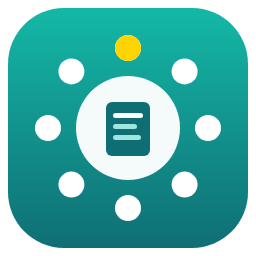
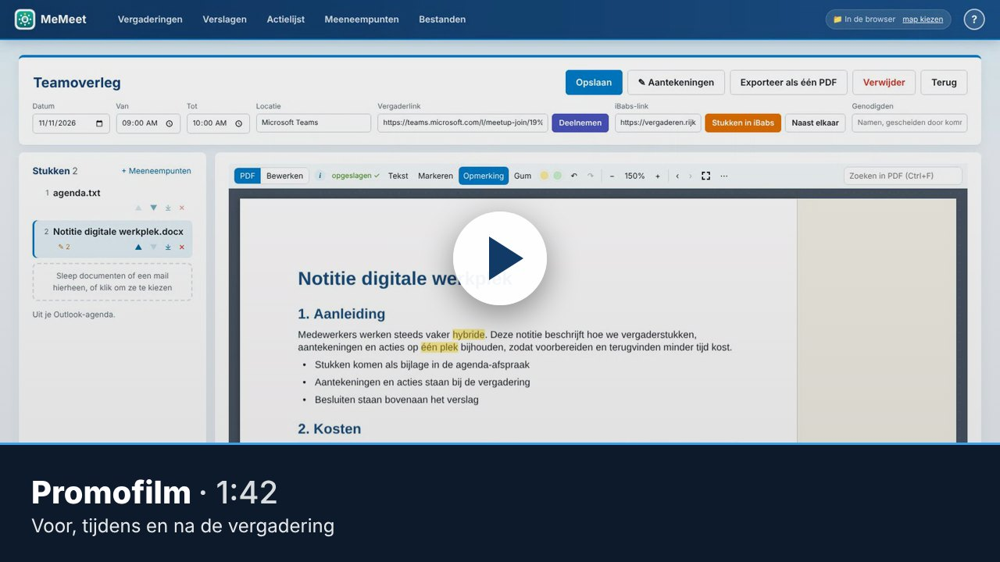
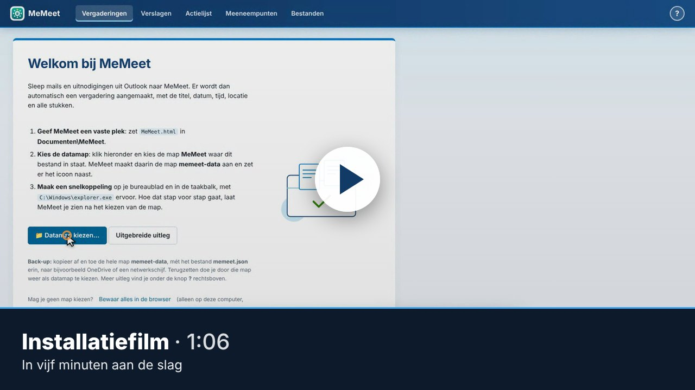
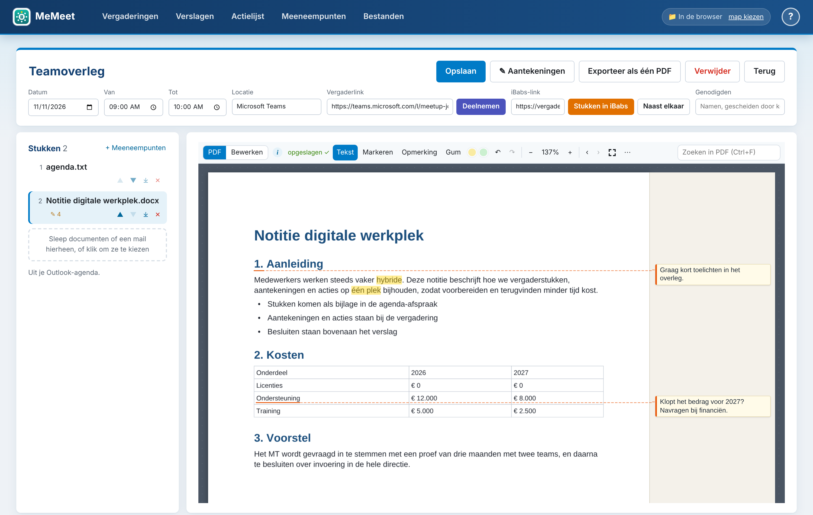
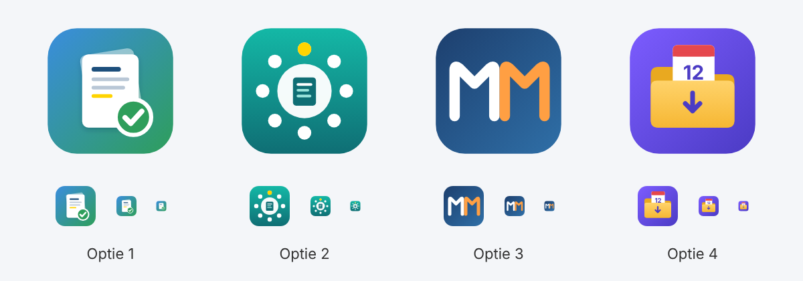
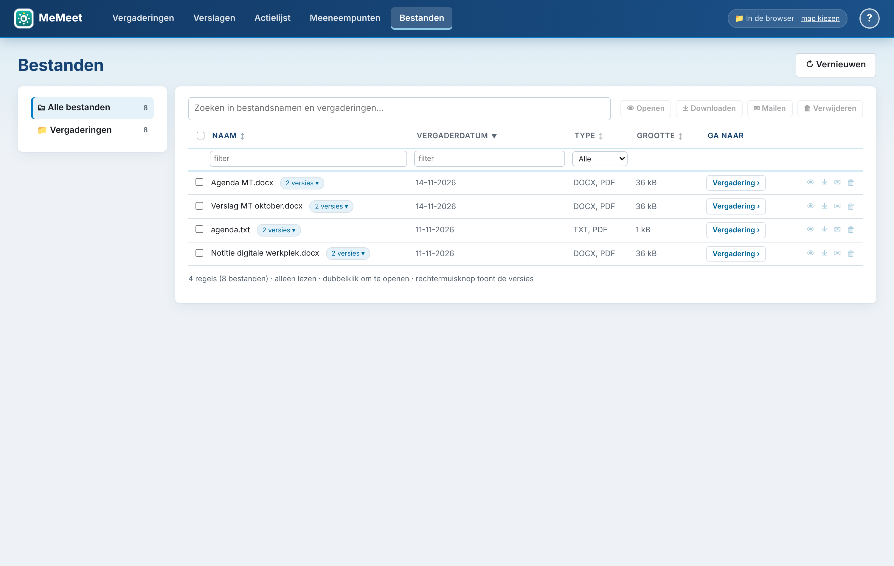

<p align="center"></p>

<h1 align="center">MeMeet</h1>

<p align="center"><b>Een lokale vergaderapp in één HTML-bestand.</b><br>
Sleep een Outlook-mail of -uitnodiging erin en je krijgt een vergadering met titel, datum, tijd, locatie, vergaderlink en alle stukken. Daarbij horen een PDF-viewer met markeren en opmerkingen, bewerken van Word, Excel en PowerPoint, aantekeningen en een actielijst.<br>
Alles blijft op je eigen computer. Er is geen server, geen installatie en geen internet nodig.</p>

---

## Filmpjes

<table>
<tr>
<td width="50%"><a href="docs/films/MeMeet-promo.mp4"></a></td>
<td width="50%"><a href="docs/films/MeMeet-installatie.mp4"></a></td>
</tr>
<tr>
<td><b><a href="docs/films/MeMeet-promo.mp4">Promofilm</a></b> (1:42): hoe je met MeMeet een vergadering voorbereidt, tijdens de vergadering aantekeningen maakt en daarna het verslag, de acties en de punten voor het volgende overleg afhandelt.</td>
<td><b><a href="docs/films/MeMeet-installatie.mp4">Installatiefilm</a></b> (1:06): downloaden, een vaste plek geven, de datamap kiezen, een snelkoppeling maken en je eerste vergadering inlezen.</td>
</tr>
</table>

De films hebben geen geluid; de uitleg staat in beeld. Klik op een plaatje om de film te openen. Speelt hij niet af in je browser, download hem dan en open hem op je computer.

---

## Inhoud

- [Filmpjes](#filmpjes)
- [Wat kan MeMeet?](#wat-kan-memeet)
- [Installatie voor gebruikers (5 minuten)](#installatie-voor-gebruikers-5-minuten)
  - [Stap 1. MeMeet downloaden](#stap-1-memeet-downloaden)
  - [Stap 2. Een vaste plek geven](#stap-2-een-vaste-plek-geven)
  - [Stap 3. Openen in Edge](#stap-3-openen-in-edge)
  - [Stap 4. De datamap kiezen](#stap-4-de-datamap-kiezen)
  - [Stap 5. Snelkoppeling met icoon (optioneel)](#stap-5-snelkoppeling-met-icoon-optioneel)
- [Dagelijks gebruik](#dagelijks-gebruik)
- [De datamap](#de-datamap)
- [Bijwerken naar een nieuwe versie](#bijwerken-naar-een-nieuwe-versie)
- [Back-up en verhuizen](#back-up-en-verhuizen)
- [Problemen oplossen](#problemen-oplossen)
- [Privacy en beveiliging](#privacy-en-beveiliging)
- [Voor ontwikkelaars: zelf bouwen](#voor-ontwikkelaars-zelf-bouwen)
- [Projectstructuur](#projectstructuur)
- [Bekende beperkingen](#bekende-beperkingen)
- [Licentie](#licentie)

---

## Wat kan MeMeet?

| | |
|---|---|
| **Mail → vergadering** | Sleep een `.msg` (Outlook) of `.eml` in het venster. MeMeet haalt de titel, datum, tijd, locatie en de **vergaderlink** (Teams, Zoom, Webex en Google Meet, ook als de link in Safe Links verpakt is) eruit en zet de bijlagen als stukken bij de vergadering. Bij een **terugkerende afspraak** krijgt de vergadering de datum en tijd van de eerstvolgende keer, met overgeslagen en verplaatste keren meegerekend. Een link naar **iBabs** komt in een eigen veld, apart van de vergaderlink. |
| **Overzicht** | Bovenaan een begroeting met het aantal vergaderingen van vandaag, en een willekeurige wijsheid of uitspraak over leiderschap (met ↻ zie je een andere). Daaronder de blokken **Vandaag** (met een knop *Deelnemen*, en *iBabs* als de stukken in iBabs staan; in- en uit te klappen, na 20:30 standaard ingeklapt) en **Morgen** (ook in- en uit te klappen), en een lijst **Volgende vergaderingen** (vanaf overmorgen) die je kunt sorteren en die standaard is ingeklapt (klik op *weergeven*). Vergaderingen die geweest zijn, staan onder een **Archief** dat je ook openklapt. De zoekbalk verschijnt zodra een van beide lijsten open is. |
| **Stukken als PDF** | Word, Excel, PowerPoint, afbeeldingen, tekst en mails worden automatisch omgezet naar PDF. PowerPoint-dia's worden getrouw weergegeven: thema en diamaster, achtergronden, vormen, afbeeldingen, tabellen, grafieken en SmartArt. Zoeken in de PDF werkt ook voor dia's. |
| **Viewer** | Je kunt zoeken in de PDF (Ctrl+F), tekst selecteren en kopiëren, **markeren** in geel of groen, en **opmerkingen** maken. Opmerkingen staan in de rechtermarge, met een pijltje naar het woord, in 9 pt. Ongedaan maken en Opnieuw werken tot 20 stappen. |
| **Bewerken** | Een bewerkomgeving voor Word (stijlen, vet, cursief, onderstrepen, uitlijnen), Excel (raster, formulebalk, formules) en PowerPoint (dia's met miniaturen). Het originele bestand blijft netjes en opent gewoon in Office. Ongedaan maken en Opnieuw werken tot 20 stappen. |
| **Exporteren** | De hele vergadering wordt één PDF: een agendapagina, daarna alle stukken met paginanummers, bladwijzers en je aantekeningen. |
| **iBabs** | Staan de stukken in iBabs, dan opent **Stukken in iBabs** de vergadering in een eigen venster. **Naast elkaar** zet iBabs links en je aantekeningen rechts op het scherm. |
| **Aantekeningen** | Een kolom om aantekeningen te maken tijdens de vergadering. Een regel die begint met `!` wordt een actie, met `=` een besluit en met `>` een meeneempunt voor een andere vergadering. Alles wordt opgeslagen als `jjjjmmdd Titel.txt`. |
| **Verslagen** | Alle aantekeningen op een rij, te sorteren op naam, datum en datum gewijzigd. Klik op een verslag om het te bewerken in een Word-achtige editor (koppen, vet, cursief, onderstreept, lijsten). Wijzigingen worden automatisch bewaard. Webadressen worden vanzelf links die je met een klik in een nieuw tabblad opent. |
| **Actielijst** | Alle acties (uit vergaderingen en losse acties die je zelf toevoegt) met de vergaderdatum. Je kunt acties bewerken, afvinken en van de lijst halen (de regel blijft in de aantekeningen staan). Je kunt een begindatum opgeven en **snoozen** naar morgen, overmorgen, volgende week of een datum die je kiest. |
| **Meeneempunten** | Lijstjes met punten om mee te nemen naar een vergadering (heette eerder Bespreekpunten), met dezelfde editor als de verslagen. Koppel een lijstje aan een vergadering, laat het **wachten op een vergadering met een bepaalde titel** (bijvoorbeeld *Linda* of *MT*), of laat het los staan. Punten die je in je aantekeningen typt als `> MT: punt`, komen er vanzelf in. |
| **Bestanden** | Een verkenner met alle bestanden: zoeken, filteren per kolom, openen, downloaden, **mailen** (als conceptmail met bijlage) en naar de vergadering springen. Met **Verwijderen** haal je een bestand uit het overzicht zonder het uit de vergadering te halen. Bestanden kun je hier alleen bekijken, niet bewerken. | Hetzelfde bestand in een ander formaat of een vorige versie (PDF-versie, *(oorspronkelijk)*) staat op één regel; klik met de **rechtermuisknop** (of op *versies*) om alle versies te zien, elk met een eigen download- en mailknop. Aantekeningen, de actielijst en originele mails staan niet in dit overzicht: die vind je in de tabbladen Verslagen en Actielijst en in de vergadering zelf.

<p align="center"></p>

---

## Installatie voor gebruikers (5 minuten)

**Wat je nodig hebt:** Windows 10 of 11 met **Microsoft Edge** of **Google Chrome**, een recente versie. Je hebt geen beheerdersrechten nodig en er wordt niets geïnstalleerd.

> Liever kijken dan lezen? De [installatiefilm](docs/films/MeMeet-installatie.mp4) (1:06) laat alle stappen hieronder zien.

> MeMeet werkt niet goed in Firefox of Safari. Die browsers kunnen niet met mappen op je computer werken.

### Stap 1. MeMeet downloaden

1. Ga naar de map [`dist/`](dist/) in deze repository.
2. Klik op **`MeMeet.html`** en dan rechtsboven op **Download raw file** (het pijltje naar beneden).
   Of download de hele repository: de groene knop **Code**, dan **Download ZIP**, en pak die uit.

> Alleen `MeMeet.html` heb je nodig. Bij een nieuwe versie komt de vorige in [`dist/archive/`](dist/archive/), voor het geval je terug wilt. Alle code en bibliotheken zitten in dat ene bestand, ongeveer 2,5 MB.

### Stap 2. Een vaste plek geven

Zet `MeMeet.html` op een vaste plek, bijvoorbeeld:

```
Documenten\MeMeet\MeMeet.html
```

Maak de map **MeMeet** in **Documenten** aan als die nog niet bestaat. Op die plek kun je het bestand later ook makkelijk vervangen door een nieuwe versie.

### Stap 3. Openen in Edge

- Dubbelklik op `MeMeet.html`. Opent het bestand in een ander programma, klik dan met de rechtermuisknop en kies **Openen met** › **Microsoft Edge**.
- Maak er een favoriet van met **Ctrl+D**, of zet het in de favorietenbalk.

### Stap 4. De datamap kiezen

De eerste keer laat MeMeet een korte uitleg zien.

1. Klik op **📁 Datamap kiezen…**.
2. Kies de map **MeMeet** waar `MeMeet.html` in staat (stap 2) en klik op **Map selecteren**.
3. Edge vraagt: *"MeMeet wil wijzigingen in bestanden opslaan"*. Klik op **Wijzigingen opslaan**.

MeMeet maakt dan zelf de map **memeet-data** aan en zet het icoon naast `MeMeet.html`:

```
Documenten\MeMeet\
  MeMeet.html
  MeMeet.ico        het icoon voor de snelkoppeling
  memeet-data\
    Vergaderingen\    per vergadering een submap met de stukken
    Aantekeningen\    de aantekeningen per vergadering (jjjjmmdd Titel.txt)
    Actielijst\       Actielijst.txt
    Meeneempunten\    de lijstjes met meeneempunten (Titel [code].txt)
    memeet.json       het register van MeMeet (niet zelf aanpassen)
```

Kies je een map waarin al gegevens van MeMeet staan (bijvoorbeeld je oude datamap), dan gebruikt MeMeet die gewoon.

> **Elke keer dat je MeMeet opent**, vraagt Edge één keer of MeMeet de map opnieuw mag gebruiken. Dat is een beveiligingsregel van de browser. Klik op **Map openen** en daarna op **Toestaan**.

> Mag je geen map kiezen, bijvoorbeeld omdat de beheerder dat heeft uitgezet? Kies dan **bewaar alles in de browser**. MeMeet werkt dan ook, maar alleen in deze browser op deze computer.

### Stap 5. Snelkoppeling op het bureaublad en in de taakbalk

Na het kiezen van de datamap opent MeMeet de pagina **MeMeet installeren**, met deze stappen en jouw eigen pad. Later vind je alles terug onder de helpknop **?** rechtsboven.

1. Klik met de rechtermuisknop op een lege plek op het bureaublad en kies **Nieuw** › **Snelkoppeling**.
2. Plak bij *Typ de locatie van het item* deze regel, met het pad naar jouw `MeMeet.html` (de installatiepagina heeft een knop **Kopiëren**):
   ```
   C:\Windows\explorer.exe "C:\Users\JOUWNAAM\Documents\MeMeet\MeMeet.html"
   ```
3. Klik op **Volgende**, noem hem **MeMeet** en klik op **Voltooien**.
4. Rechtermuisknop › **Eigenschappen** › **Ander pictogram…** › **Bladeren** en kies `MeMeet.ico` naast `MeMeet.html`.
5. Sleep de snelkoppeling naar de **taakbalk**, of kies met de rechtermuisknop **Aan taakbalk vastmaken** (in Windows 11 eerst **Meer opties weergeven**).

Doordat het doel een programma is (`explorer.exe`) en niet het HTML-bestand zelf, kun je de snelkoppeling aan de taakbalk vastmaken. Explorer opent MeMeet dan in je standaardbrowser.

<p align="center"></p>

---

## Dagelijks gebruik

> Op elke pagina staat rechtsboven een knop **?** (of druk op **F1**). Die opent uitleg over de pagina waar je bent, **veelgestelde vragen** (installeren, snelkoppeling, back-up, upgraden, doorontwikkelen, veiligheid) en een algemene uitleg over hoe MeMeet werkt.

**Een vergadering aanmaken**
- Sleep een mail of uitnodiging uit Outlook naar het MeMeet-venster. Controleer de gegevens en klik op **Opslaan**.
- Lukt slepen niet (soms in de nieuwe Outlook)? Sleep de mail dan eerst naar je bureaublad en vandaar naar MeMeet. Of gebruik **Mail importeren…**.
- Sleep je meerdere mails tegelijk, dan maakt MeMeet ze allemaal in één keer aan.

**Weekagenda importeren**
- Klik op **📅 Importeer weekagenda** bij Vergaderingen. Daar staat ook de uitleg.
- Sla in Outlook je agenda op als `.ics`: ga naar **Agenda**, kies **Bestand › Agenda opslaan in bestand › Meer opties**, kies een datumbereik (bijvoorbeeld *Volgende 7 dagen*) en **Volledige details**.
- Kies dat bestand in MeMeet, of sleep het erin. Je ziet eerst een lijst van alle afspraken. **Vink uit wat je niet wilt** en klik op **Importeer geselecteerde**. Blokken, reistijd, uitloop en korte afspraken (tot 20 minuten) die direct naast een andere vergadering liggen, worden niet geïmporteerd. Met **⚙ Niet importeren…** pas je de trefwoorden en de minuten aan en zie je welke titels je eerder hebt uitgevinkt. Afspraken waarvan geen titel te vinden is, worden niet geïmporteerd. Wat je uitvinkt, staat de volgende keer ook uit.
- Elke aangevinkte afspraak wordt een vergadering, met datum, tijd, locatie, vergaderlink en genodigden (de organisator vooraan). Een link naar iBabs in de tekst van de afspraak komt in het veld **iBabs-link**. Een import zonder iBabs-link laat een bestaande of zelf geplakte link staan.
- **Bijlagen** van een afspraak worden stukken. Mails die als bijlage in de afspraak zitten (`.msg` of `.eml`), worden omgezet naar PDF. Vink daarvoor in Outlook bij **Meer opties** onder **Geavanceerd** ook **Bijlagen bij agenda-items opnemen** aan.
- Je kunt elke week opnieuw importeren. Bestaande vergaderingen worden bijgewerkt, ook als je ze eerder via een uitnodiging hebt aangemaakt. Stukken en aantekeningen blijven staan.
- Hele-dag-afspraken, geannuleerde afspraken en afspraken die al geweest zijn, worden overgeslagen. Een afspraak die je in Outlook verwijdert, blijft in MeMeet staan.
- **Sneltoets zonder macro:** voeg via **Bestand › Opties › Werkbalk Snelle toegang** de opdracht **Opslaan als agenda** toe (kies *Alle opdrachten*). In de agenda opent **Alt + het cijfer van die knop** dan meteen het venster om de agenda op te slaan.
- **Sneltoets met macro (optioneel):** de macro in [`outlook/MeMeet-weekagenda.bas`](outlook/MeMeet-weekagenda.bas) slaat met één klik de komende 7 dagen op in je map Downloads. Op de importpagina staat hoe je hem instelt, met een knop om de code te kopiëren. Dit werkt alleen in de klassieke Outlook voor Windows en alleen als je organisatie macro's toestaat.

**Genodigden**
- Vul de namen in, gescheiden door komma's. De **eerste naam is de voorzitter**.

**iBabs**
- Een vergadering heeft twee links: de **Vergaderlink** (Teams, Zoom en dergelijke) voor **Deelnemen**, en de **iBabs-link** naar de stukken. MeMeet herkent een iBabs-link aan `https://vergaderen.rijksweb.nl/` of aan "ibabs" in de domeinnaam, bij inslepen en bij de weekimport. Een link naar een vergadering (`/Meeting/View/`) gaat voor. Je kunt de link ook zelf plakken of wijzigen.
- **Stukken in iBabs** (op de vergaderpagina, en als oranje knop *iBabs* bij Vandaag en Morgen) opent iBabs in een eigen venster, zonder tabbladen. Een klik bij een andere vergadering laadt die in hetzelfde venster.
- **Naast elkaar** zet iBabs links op het scherm en je aantekeningen rechts, elk in een eigen venster. Houdt Edge het tweede venster tegen, sta dan één keer pop-ups toe voor MeMeet. De vensters komen op het scherm waar MeMeet staat; het venster van MeMeet zelf verschuift niet. iBabs in MeMeet zelf tonen kan niet: iBabs staat dat niet toe.
- Bij oudere vergaderingen kan de iBabs-link nog in het veld Vergaderlink staan (dan opende *Deelnemen* iBabs). Knip hem daar weg en plak hem bij iBabs-link.

**Vergaderingen verwijderen**
- Open een vergadering en klik op **Verwijder**, of vink in de lijst bij Vergaderingen meerdere vergaderingen aan en klik op **🗑 Verwijderen** in de balk die onderaan verschijnt.
- Bij verwijderen uit de lijst wordt alles gewist wat bij de vergadering hoort: de map met stukken, de originele mail, gewijzigde versies, de aantekeningen en de acties.

**Stukken**
- Sleep documenten op een geopende vergadering.
- Met ▲▼ bepaal je de volgorde, die ook geldt voor de export.
- Sleep je een bestand met **dezelfde naam** op de vergadering, dan vraagt MeMeet of het de oude versie moet vervangen. Zo werk je een stuk bij dat je in Word zelf hebt aangepast.

**Viewer**

| Knop | Wat het doet |
|---|---|
| **Tekst** | Tekst selecteren en kopiëren (Ctrl+C). |
| **Markeren** | Selecteer tekst; die wordt gemarkeerd in geel of groen. |
| **Opmerking** | Klik op een woord en typ. De opmerking komt in de rechtermarge. Ctrl+Enter = klaar. |
| **Gum** | Klik op een markering of opmerking om die te verwijderen. |
| ↶ ↷ | Ongedaan maken en opnieuw, tot 20 stappen (Ctrl+Z en Ctrl+Y). |
| Zoekvak | Zoeken in de PDF (Ctrl+F), daarna Enter voor de volgende treffer. |

Alle knoppen staan op één regel boven het stuk. In een smalle kolom tonen Tekst, Markeren, Opmerking en Gum alleen een symbool (Aa, 🖍, 💬, ⌫); de naam staat in de tooltip.
| − 100% + | Kleiner en groter. Ingezoomd kun je met de horizontale schuifbalk de hele pagina zien. Klik op het percentage om de pagina weer passend te maken. |
| ⛶ | De viewer tijdelijk vergroten tot het hele browservenster. Nog een keer klikken of Esc maakt hem weer klein. Werkt ook bij Bewerken. |
| ⋯ | Het stuk downloaden met je aantekeningen, of het origineel downloaden. |

**Bewerken** (tabblad boven de viewer)
- Word: stijlen, **B** *I* U, opsomming en uitlijnen.
- Excel: typ in een cel. Met Enter, Tab en de pijltjes beweeg je, met F2 pas je een cel aan, met Delete wis je hem, en met `=` begin je een formule.
- PowerPoint: de dia's zien er hetzelfde uit als in de PDF. Klik in een tekstvak op de dia om de tekst aan te passen.
- Opslaan doe je met **💾 Opslaan** of **Ctrl+S**. De eerste keer bewaart MeMeet een kopie `(oorspronkelijk)` en daarna wordt de PDF bijgewerkt.

**Aantekeningen en acties**
- Klik op **✎ Aantekeningen** voor de kolom rechts. Versleep de linkerrand om de kolom breder of smaller te maken, of klik op **⧉ Apart venster** om de aantekeningen in een eigen venster rechts op je scherm te zetten, naast andere programma's. Een regel die met `!` begint, wordt een actie, bijvoorbeeld `! Jan stuurt de notitie rond`.
- Een regel die met `=` begint, is een **besluit**, bijvoorbeeld `= livegang schuift naar maart`. Een regel die met `>` begint, is een **meeneempunt** voor een andere vergadering (zie Meeneempunten). Je tekst blijft staan zoals je hem typt, ook in het tekstbestand.
- In het tabblad **Actielijst** voeg je ook **losse acties** toe, zonder vergadering: typ ze in het vak bovenaan en klik op **+ Toevoegen** (of Enter). Je kunt acties bewerken, afvinken, ⏰ snoozen, een begindatum geven en van de lijst halen. Wat je van de lijst haalt, staat onder *Verwijderd* en kun je terugzetten.

**Verslag mailen**
- In de kolom **✎ Aantekeningen** en in het verslag (tabblad Verslagen) staat **✉ Mailen**. Outlook opent dan een nieuwe mail met de tekst van je aantekeningen; je vult zelf de ontvanger in. Is de tekst lang, dan downloadt MeMeet een conceptmail (`.eml`): open dat bestand en Outlook toont een nieuwe mail met de hele tekst.
- De mail begint met de **besluiten** (`=`), dan de **acties** (`!`), dan de overige aantekeningen in de volgorde waarin je ze typte, elk onder een kopje. Kopjes zonder regels worden weggelaten. **Meeneempunten** (`>`) zijn privé en gaan niet mee.

**Downloads**
- Bij elke download (PDF, conceptmail, tekstbestand) staat rechtsonder even een balkje met **Opnieuw downloaden**. Blokkeert de browser de download omdat die pas na wat rekenwerk begint, dan helpt die knop. Komt er dan nog niets, sta automatische downloads toe in Edge: *Instellingen › Cookies en sitemachtigingen › Automatische downloads*.

**Meeneempunten** (heette eerder Bespreekpunten)
- Het tabblad **Meeneempunten** bevat lijstjes in verslagvorm, voor punten die je wilt inbrengen, voorbereiding, ideeën of gespreksnotities. Koppel een lijstje aan een vergadering, laat het wachten op een vergadering met een bepaalde titel, of laat het los. Op de vergaderpagina staan de lijstjes bovenaan de stukken. Klik op de titel om de inhoud in de kolom open of dicht te klappen (hoogstens een kwart van de kolom, met een schuifbalk); met ✎ open je het lijstje om te bewerken. Met **+ Meeneempunten** bovenaan de stukken maak je direct een lijstje bij die vergadering; zijn er al lijstjes, dan klapt de knop ze open. De grijze tekst op de lege eerste regel is dan *Meeneempunten bij* de vergadering; druk op Enter en die tekst wordt de vette titel, waarna je verder typt op de volgende regel. Een nieuw lijstje dat je leeg laat, wordt niet bewaard.
- Met **+ Meeneempuntenlijstje toevoegen** maak je een nieuw lijstje; dat opent direct als leeg document. De eerste regel is de titel (vanzelf vet); er is geen apart titelveld.
- **Wachten op een vergadering.** Vul bij **of wacht op titel** een naam of woord in, bijvoorbeeld *Linda* of *MT*. Het lijstje staat dan bij de eerstvolgende vergadering (vandaag of later) met dat woord in de titel, ook als die vergadering pas later wordt geïmporteerd of ingesleept. Er wordt gezocht op hele woorden, zonder hoofdletters en accenten: *Linda* past bij *bila Linda* en *PO Linda*, niet bij *Belinda*. De woorden bila, po, overleg, bijpraten, met, de, het en een tellen niet mee.
  - **Niet hier** (bij het lijstje op de vergaderpagina) slaat die vergadering over; het lijstje wacht dan op de volgende.
  - Is de vergadering voorbij en is het lijstje niet gearchiveerd, dan schuift het door naar de volgende passende vergadering.
  - **Vastpinnen** maakt er een vaste lijst opletpunten van: die staat bij elke passende vergadering en schuift niet door.
- **Punten uit je aantekeningen.** Een regel als `> MT: begroting agenderen` in je aantekeningen komt als punt in het lijstje *MT*. Bestaat dat lijstje nog niet, dan maakt MeMeet het aan, wachtend op een vergadering met MT in de titel. Punten met hetzelfde label uit verschillende vergaderingen komen in hetzelfde lijstje. Een punt staat bij de volgende passende vergadering, niet bij de vergadering waarin je het typte.
  - `> volgende vergadering: …` gaat naar de volgende vergadering met dezelfde titel (losse getallen en datums tellen niet mee). Zonder label, zoals `> idee uitwerken`, komt het punt in het lijstje *Nog te plaatsen*.
  - In het lijstje staan deze punten bovenaan als afvinkbare regels, met de vergadering waar ze vandaan komen; daaronder staat je eigen tekst. Met ✕ verberg je een punt. De regel blijft in je aantekeningen staan, net als bij acties.
  - Meeneempunten zijn privé: ze gaan niet mee als je je aantekeningen mailt.
- Het tabblad toont drie groepen: **Bij een vergadering of los**, **Wachtend op een vergadering** (met de volgende vergadering, of hoe lang het lijstje al wacht) en het **Archief**.
- Met **Archiveren** (in de lijst of bovenaan een lijstje) zet je een lijstje in het **Archief** onderaan het tabblad. Dat is standaard ingeklapt; met **Terugzetten** haal je het terug. Bij de vergadering blijft het zichtbaar, met het label *archief*. Bij een wachtend lijstje legt MeMeet vast bij welke vergadering het op dat moment stond.
- Lijstjes worden ook als tekstbestand bewaard in `memeet-data\Meeneempunten`, met de punten uit je aantekeningen erbij. Had je een map `Bespreekpunten` (of nog eerder `Annotaties`), dan zet MeMeet die bestanden eenmalig over naar `Meeneempunten`. Lukt dat niet, dan blijft MeMeet de oude map gebruiken. Bestaat `Meeneempunten` al, dan blijft de oude map onaangeroerd staan.

**Exporteren**
- **Exporteer als één PDF** maakt `Titel - dd-mm-jjjj uu.mm-uu.mm.pdf`. Het bestand komt in Downloads en in de map van de vergadering.

**Bestanden**
- Hier zie je alle bestanden uit de datamap. Je kunt ze openen, downloaden, ✉ mailen en met **Vergadering ›** naar de bijbehorende vergadering gaan.
- Mailen maakt een conceptmail (`.eml`) met de bijlagen. Open het gedownloade bestand en Outlook start een nieuwe mail die klaar is om te versturen.
- **🗑 Verwijderen** haalt een bestand alleen uit dit overzicht. In de vergadering en in de datamap blijft het gewoon staan. Met **Verwijderd tonen** zie je wat je hebt weggehaald, en met **↩ Terugzetten** komt het terug in het overzicht.

<p align="center"></p>

---

## De datamap

| Map of bestand | Inhoud |
|---|---|
| `Vergaderingen\2026-11-12 Titel [ab12]\` | De originele stukken, de PDF-versies, `(oorspronkelijk)`-kopieën, de originele mail en exports. |
| `Aantekeningen\20261112 Titel.txt` | Kop met datum, locatie, voorzitter en leden, daarna je aantekeningen en acties. |
| `Actielijst\Actielijst.txt` | Alle acties, ingedeeld in open, gesnoozed en afgerond. |
| `memeet.json` | Het register: vergaderingen, aantekeningen, markeringen en acties. **Niet met de hand aanpassen.** |

Elke vergadering heeft een eigen map in `Vergaderingen\`, ook als er nog geen stukken in zitten (bijvoorbeeld na het importeren van je weekagenda).

Verwijder je een vergadering in MeMeet, dan wordt de hele map in `Vergaderingen\` gewist: de stukken, de originele mail en alle gewijzigde versies. Je aantekeningen in `Aantekeningen\` blijven staan. Verwijder je vergaderingen via de lijst (aanvinken en **Verwijderen**), dan worden ook de aantekeningen gewist.

Je kunt bestanden in deze mappen gewoon openen en kopiëren. Hernoem of verwijder bestanden in `Vergaderingen\` liever niet buiten MeMeet om, want dan klopt het register niet meer.

> Gebruikte je een oudere versie, waarin alles los in de hoofdmap stond? Dan zet MeMeet je bestaande gegevens de eerste keer vanzelf in de nieuwe indeling.

---

## Bijwerken naar een nieuwe versie

1. Maak eerst een back-up (zie hieronder).
2. Open [MeMeet.html op GitHub](https://github.com/oss-aigp/memeet/blob/main/dist/MeMeet.html) en klik rechtsboven op het pijltje **Download raw file**. Het bestand komt in **Downloads**.
3. Sluit MeMeet (alle tabbladen met MeMeet).
4. Verplaats het gedownloade `MeMeet.html` naar `Documenten\MeMeet` en kies **Het bestand in de doelmap vervangen**. Heet het in Downloads `MeMeet (1).html`, geef het dan eerst de naam `MeMeet.html`.
5. Open MeMeet via je snelkoppeling. Al je vergaderingen staan er weer.

Welke versie je gebruikt, zie je onderaan het helppaneel (knop **?**).

Je gegevens staan in de datamap, niet in het HTML-bestand. Vervangen is dus veilig.

## Back-up en verhuizen

- **Back-up:** sluit MeMeet en kopieer de **hele map `memeet-data`**, mét het bestand `memeet.json` erin, bijvoorbeeld naar OneDrive, een netwerkschijf of een USB-stick. `memeet.json` is het register: daarin staan de vergaderingen, aantekeningen, acties en je markeringen en opmerkingen. Zonder dat bestand zijn alleen de losse stukken terug te halen.
- **Terugzetten of naar een andere computer:** zet de gekopieerde map `memeet-data` neer (bijvoorbeeld in `Documenten\MeMeet`), open `MeMeet.html` en kies via **wijzig** rechtsboven die map.
- Losse vergadermappen terugkopiëren in `Vergaderingen` werkt niet: MeMeet werkt vanuit `memeet.json`. Zet altijd de hele map terug.

---

## Problemen oplossen

| Probleem | Oplossing |
|---|---|
| **Er gebeurt niets als ik een mail sleep** | Sleep de mail eerst naar het bureaublad en daarna naar MeMeet. Of gebruik **Mail importeren…**. |
| **"Map kiezen lukt niet"** | Je beheerder heeft toegang tot mappen misschien geblokkeerd. Kies **bewaar alles in de browser**. |
| **Edge vraagt elke keer om toegang** | Dat is normaal, het is een beveiligingsregel van de browser. Klik op **Map openen** en dan op **Toestaan**. |
| **Een stuk heeft het label "geen PDF"** | Oude formaten (`.doc`, `.xls`, `.ppt`) kunnen niet worden omgezet. Open het bestand in Word of Excel, kies **Opslaan als** › **PDF** en sleep de PDF op de vergadering. MeMeet vraagt dan of die PDF als versie van het stuk moet dienen. |
| **De opmaak van een omgezet stuk wijkt af** | Het omzetten gebeurt zonder Word, dus de tekst klopt maar de opmaak is vereenvoudigd. Gebruik voor de exacte opmaak de PDF-route hierboven. |
| **Een gescande PDF: zoeken en markeren werkt niet** | Een scan is een afbeelding zonder tekst. Opmerkingen werken wel. |
| **De viewer blijft leeg** | Kies in ⋯ voor **PDF openen in nieuw tabblad**. |
| **De conceptmail opent als gewone mail** | Dat gebeurt in de nieuwe Outlook. Download de bestanden dan met ⤓ en sleep ze in een nieuwe mail. |
| **Ik zie mijn vergaderingen niet meer** | Kies bovenin via **wijzig** de juiste datamap. Kijk ook in het **Archief** onderaan de beginpagina. |

---

## Privacy en beveiliging

- MeMeet draait volledig **in je eigen browser**. Mails, stukken en aantekeningen worden **nergens naartoe gestuurd**.
- Er worden geen externe scripts of lettertypen geladen. Alles zit in het HTML-bestand, dus MeMeet werkt ook zonder internet.
- MeMeet heeft alleen toegang tot de ene datamap die jij kiest, en alleen nadat jij in Edge toestemming hebt gegeven.

---

## Voor ontwikkelaars: zelf bouwen

**Vereisten:** [Node.js](https://nodejs.org/) 18 of nieuwer.

```bash
git clone https://github.com/oss-aigp/memeet.git
cd memeet
npm install
npm run build        # maakt dist/MeMeet.html
```

`scripts/build.js` voegt alles samen tot één HTML-bestand:

1. de broncode uit `src/` (in een vaste volgorde, als één IIFE);
2. **pdf-lib** (PDF maken en samenvoegen) en **JSZip** (Office-bestanden lezen en schrijven);
3. **pdf.js**: de viewer, de tekstlaag en zoeken. Dit wordt met esbuild omgezet van ES-module naar een klassiek script, zodat het ook vanaf `file://` werkt;
4. het icoon `src/icon.svg`, als favicon en logo;
5. de Outlook-macro `outlook/MeMeet-weekagenda.bas`, zodat gebruikers die op de importpagina kunnen kopiëren.

**Testen tijdens het ontwikkelen:** open `dist/MeMeet.html` in Edge of Chrome. Wil je de testhaken gebruiken, zet dan `window.__VA_TEST = 1` voordat het script laadt, bijvoorbeeld via Playwright `addInitScript`. Dan zijn interne functies beschikbaar onder `window.__va`.

### Projectstructuur

```
memeet/
├─ dist/
│  ├─ MeMeet.html        ← het gebouwde bestand (dit gebruiken)
│  └─ archive/           ← alle eerdere versies (MeMeet-v<versie>.html)
├─ src/
│  ├─ app.html           ← HTML-sjabloon en alle CSS
│  ├─ mail-parser.js     ← .msg (CFB/OLE) en .eml (MIME) lezen; datum/tijd/locatie/link herkennen
│  ├─ convert.js         ← omzetten naar PDF (Word/Excel/tekst/afbeelding), aantekeningen
│  ├─ pptx-render.js     ← PowerPoint-dia's getrouw tekenen (voor de PDF en de bewerkomgeving)
│  │                       in de PDF zetten, vergadering exporteren als één PDF
│  ├─ editor.js          ← bewerkomgevingen Word/Excel/PowerPoint/tekst met ongedaan maken en opnieuw
│  ├─ notes.js           ← aantekeningen tijdens de vergadering en de actielijst (snooze, begindatum)
│  ├─ reports.js         ← tabblad Verslagen (lijst en Word-achtige editor), mailen
│  ├─ annotations.js     ← tabblad Meeneempunten
│  ├─ files.js           ← tabblad Bestanden (alleen lezen, zoeken, filteren, mailen)
│  ├─ help.js            ← helppaneel per pagina (knop ? en F1)
│  ├─ app-ui.js          ← opslag (map / IndexedDB), routes, overzicht, vergaderpagina,
│  │                       PDF-viewer met markeren/opmerkingen/zoeken
│  └─ icon.svg           ← app-icoon (optie 2, Tafel)
├─ outlook/
│  └─ MeMeet-weekagenda.bas ← Outlook-macro: agenda van de komende 7 dagen opslaan als .ics
├─ icons/                ← vier icoonontwerpen als SVG, PNG en ICO
├─ docs/                 ← schermafbeeldingen voor deze README, en in films/ de promo- en installatiefilm
├─ scripts/build.js      ← bouwscript
├─ LICENSE               ← EUPL-1.2
├─ THIRD-PARTY-NOTICES.md ← licenties van pdf.js, pdf-lib en JSZip
└─ package.json
```

**Gebruikte techniek:** gewone JavaScript zonder framework, de File System Access API (`showDirectoryPicker`), IndexedDB voor de mapkoppeling en als reserveopslag, pdf.js, pdf-lib en JSZip.

---

## Bekende beperkingen

- **Alleen Edge of Chrome**, vanwege de File System Access API.
- **Omzetten naar PDF gebeurt zonder Office:** bij Word en Excel is de opmaak vereenvoudigd. Oude formaten (`.doc`, `.xls`, `.ppt`) worden niet omgezet.
- **PowerPoint:** dia's worden als afbeelding in de PDF gezet, met de tekst er onzichtbaar overheen (zodat zoeken werkt). Grafieken worden eenvoudig nagetekend (staaf, lijn, vlak, cirkel, ring); andere soorten grafieken, 3D-effecten, schaduwen, animaties en afbeeldingen in EMF/WMF-formaat worden niet of vereenvoudigd getoond. Lettertypen die niet op je computer staan, worden vervangen. Verborgen dia's komen niet in de PDF.
- **Oudere PowerPoint-stukken** worden de eerste keer dat je ze opent opnieuw omgezet met de nieuwe weergave, behalve als je er al aantekeningen op hebt gezet. Dan blijft de oude PDF staan; sleep het bestand opnieuw op de vergadering voor de nieuwe weergave.
- **Bewerken:** in Word kun je geen afbeeldingen of tabellen invoegen, en alinea's met een afbeelding kun je niet bewerken. In Excel kun je de opmaak van cellen niet veranderen. In PowerPoint kun je geen vormen of dia's toevoegen. Voor zulke dingen download je het bestand en bewerk je het in Office zelf.
- **Mappen openen in Verkenner** vanuit MeMeet kan niet, want een browser mag dat niet. Open de map zelf via Verkenner.
- **Toestemming:** Edge vraagt bij elke start één keer of MeMeet de map opnieuw mag gebruiken.

---

## Licentie

MeMeet © oss-aigp en bijdragers.

MeMeet is open source onder de **European Union Public Licence v. 1.2** (EUPL-1.2): zie [`LICENSE`](LICENSE). De EUPL is de open-sourcelicentie van de Europese Unie en is in alle EU-talen even geldig, ook in het [Nederlands](https://eur-lex.europa.eu/legal-content/NL/TXT/?uri=CELEX:32017D0863).

In het kort: je mag MeMeet gebruiken, bestuderen, aanpassen en verspreiden. Verspreid je een aangepaste versie, dan stel je die ook beschikbaar onder de EUPL (of een daarmee verenigbare licentie, zoals de GPL), met de broncode erbij. De software wordt geleverd zonder garantie.

`dist/MeMeet.html` bevat ook onderdelen van anderen met hun eigen licentie: pdf.js (Apache-2.0), pdf-lib met de onderdelen die het meebrengt (MIT, MIT AND Zlib, 0BSD) en JSZip (MIT of GPL-3.0). De volledige teksten staan in [`THIRD-PARTY-NOTICES.md`](THIRD-PARTY-NOTICES.md).
